# Secure Serverless Application Architecture on Google Cloud Platform

**Cloud Run | Terraform | Cloud Armor WAF | Application Load Balancer | Cloud Logging | Cloud Monitoring**

## 1. Project Overview

This project demonstrates the implementation of a **security-focused, containerized serverless application architecture on Google Cloud Platform (GCP)**.

The application is deployed on **Google Cloud Run** and connected to an **External Application Load Balancer** using a Serverless Network Endpoint Group (NEG).

A **Cloud Armor Web Application Firewall (WAF)** policy provides request filtering, while **Terraform** manages the load-balancing and security infrastructure as code.

**Cloud Logging and Cloud Monitoring** provide application visibility, request metrics, latency monitoring, and alerting.

### Project Objectives

- Deploy a containerized application on Google Cloud Run.
- Configure restricted Cloud Run ingress.
- Implement an external HTTP Application Load Balancer.
- Connect Cloud Run to the load balancer using a serverless NEG.
- Configure Cloud Armor WAF security rules.
- Manage cloud infrastructure using Terraform.
- Enable request logging and monitoring.
- Create monitoring dashboards and alerting policies.
- Validate infrastructure configuration and Terraform state.

---

## 2. Architecture Diagram


### Application Request Flow

```text
Internet Users
      |
      v
External HTTP Application Load Balancer
      |
      v
Backend Service + Cloud Armor WAF
      |
      v
Serverless Network Endpoint Group
      |
      v
Google Cloud Run
      |
      v
Containerized Application
```

### Supporting Components

- **Artifact Registry:** Stores the application container image.
- **Cloud Logging:** Collects Cloud Run and load balancer request logs.
- **Cloud Monitoring:** Tracks request counts, latency, and alert conditions.
- **Terraform:** Manages the networking and Cloud Armor infrastructure.

---

## 3. Technologies Used

| Category | Technologies |
|---|---|
| Cloud Platform | Google Cloud Platform |
| Compute | Google Cloud Run |
| Container Registry | Google Artifact Registry |
| Networking | External Application Load Balancer, Serverless NEG |
| Security | Google Cloud Armor WAF, Cloud Run Ingress Controls |
| Infrastructure as Code | Terraform |
| Logging | Google Cloud Logging |
| Monitoring | Google Cloud Monitoring |
| Command Line | Google Cloud CLI, Cloud Shell |

---

# 4. Implementation Workflow

## Step 1: Google Cloud Project Configuration

Created and configured the Google Cloud project.

**Project ID:** `secure-serverless-portfolio`

### Set the Active Project

```bash
gcloud config set project secure-serverless-portfolio
```

Verified that billing was enabled.

### Enable Required APIs

```bash
gcloud services enable run.googleapis.com
gcloud services enable artifactregistry.googleapis.com
gcloud services enable compute.googleapis.com
gcloud services enable logging.googleapis.com
gcloud services enable monitoring.googleapis.com
```

These APIs support serverless computing, container storage, networking, logging, and monitoring.

---

## Step 2: Container Image and Artifact Registry

The application container image was stored in **Google Artifact Registry**.

**Repository Name:** `secure-app-repo`

**Container Image:**

```text
us-central1-docker.pkg.dev/secure-serverless-portfolio/secure-app-repo/secure-app:v1
```

Artifact Registry provides managed storage for the application image deployed to Cloud Run.

---

## Step 3: Deploy the Application on Cloud Run

Deployed the containerized application using Google Cloud Run.

### Cloud Run Configuration

| Property | Configuration |
|---|---|
| Service Name | secure-app |
| Region | us-central1 |
| Container Port | 8080 |
| Memory | 512 MiB |
| CPU | 1 vCPU |
| Minimum Instances | 0 |
| Maximum Instances | 3 |
| Ingress | Internal and Cloud Load Balancing |

The ingress configuration restricts direct public access to the Cloud Run service and permits supported requests through Cloud Load Balancing.

### Verify Cloud Run Deployment

```bash
gcloud run services describe secure-app \
  --region=us-central1
```

### Result: Cloud Run Service Configuration

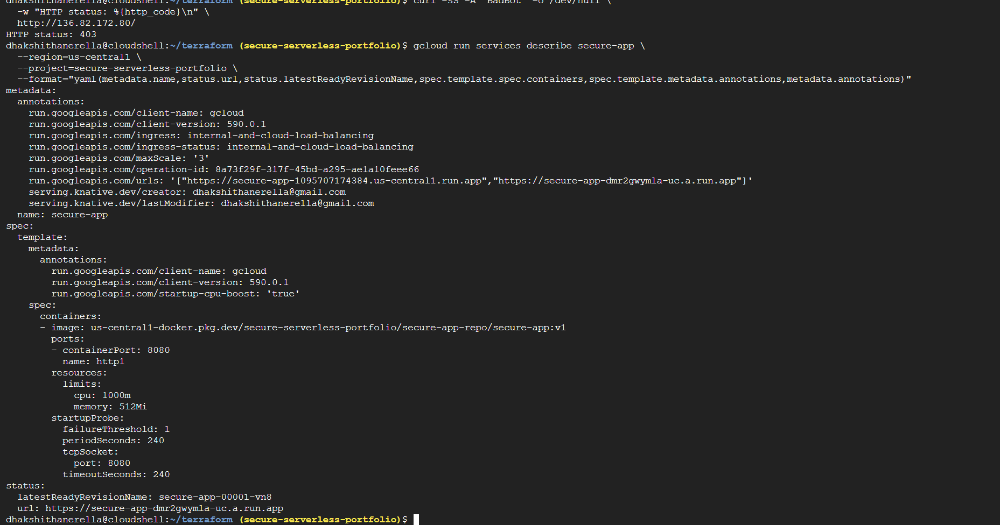

The service details confirmed the deployed container image, resource configuration, region, and ingress settings.

---

## Step 4: Configure Terraform

Terraform was used to manage the networking and security resources.

### Terraform Files

```text
terraform/
├── main.tf
├── provider.tf
└── variables.tf
```

### variables.tf

Defined reusable variables for the Google Cloud project and region.

```hcl
variable "project_id" {
  description = "The GCP Project ID"
  type        = string
}

variable "region" {
  description = "The GCP Region"
  type        = string
  default     = "us-central1"
}
```

### provider.tf

Configured the Google Cloud provider.

```hcl
terraform {
  required_providers {
    google = {
      source  = "hashicorp/google"
      version = "~> 4.0"
    }
  }
}

provider "google" {
  project = var.project_id
  region  = var.region
}
```

### Terraform-Managed Resources

The Terraform configuration manages six resources:

1. Cloud Armor Security Policy
2. Serverless Network Endpoint Group
3. Backend Service
4. URL Map
5. HTTP Target Proxy
6. Global Forwarding Rule

---

## Step 5: Implement Cloud Armor WAF

Created a Cloud Armor security policy named **`secure-app-waf`**.

The policy contains a custom rule that denies requests containing `BadBot` in the User-Agent header.

All other requests are permitted by the default allow rule.

### Terraform Configuration

```hcl
resource "google_compute_security_policy" "waf_policy" {
  name = "secure-app-waf"

  rule {
    action   = "deny(403)"
    priority = 1000

    match {
      expr {
        expression = "request.headers['user-agent'].contains('BadBot')"
      }
    }

    description = "Block BadBot traffic"
  }

  rule {
    action   = "allow"
    priority = 2147483647

    match {
      versioned_expr = "SRC_IPS_V1"

      config {
        src_ip_ranges = ["*"]
      }
    }

    description = "Default allow"
  }
}
```

### Result: Cloud Armor WAF Rules

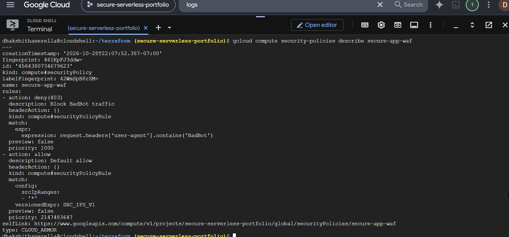

The policy configuration shows the custom deny rule and the default allow rule.

The `BadBot` rule demonstrates application-layer request filtering rather than comprehensive bot protection.

---

## Step 6: Configure Serverless Network Endpoint Group

Created a **Serverless Network Endpoint Group (NEG)** to connect the load balancer backend to the Cloud Run service.

**NEG Name:** `secure-app-neg`

### Terraform Configuration

```hcl
resource "google_compute_region_network_endpoint_group" "serverless_neg" {
  name                  = "secure-app-neg"
  network_endpoint_type = "SERVERLESS"
  region                = var.region

  cloud_run {
    service = "secure-app"
  }
}
```

The serverless NEG provides the integration between the load balancer backend and the Cloud Run application.

---

## Step 7: Configure Backend Service and Logging

Created a backend service named **`secure-app-backend`**.

The backend service connects the serverless NEG to the load balancer and attaches the Cloud Armor security policy.

### Terraform Configuration

```hcl
resource "google_compute_backend_service" "backend" {
  name     = "secure-app-backend"
  protocol = "HTTP"

  backend {
    group = google_compute_region_network_endpoint_group.serverless_neg.id
  }

  security_policy = google_compute_security_policy.waf_policy.id

  log_config {
    enable      = true
    sample_rate = 1.0
  }
}
```

### Configuration Details

- Connected the backend service to the serverless NEG.
- Attached the Cloud Armor WAF security policy.
- Enabled backend request logging.
- Configured a logging sample rate of 100%.

### Verify Backend Configuration

```bash
gcloud compute backend-services describe secure-app-backend \
  --global \
  --format="yaml(name,securityPolicy,backends,logConfig)"
```

### Result: Backend Service and Logging Configuration

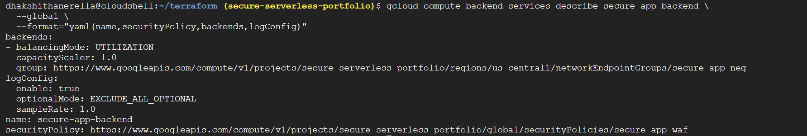

The output confirmed that the backend service references the serverless NEG, the Cloud Armor security policy is attached, and backend logging is enabled.

---

## Step 8: Configure External Application Load Balancer

Configured an external HTTP Application Load Balancer using a URL map, HTTP target proxy, and global forwarding rule.

### 8.1 Create URL Map

The URL map routes incoming requests to the backend service.

```hcl
resource "google_compute_url_map" "url_map" {
  name            = "secure-app-url-map"
  default_service = google_compute_backend_service.backend.id
}
```

### 8.2 Create HTTP Target Proxy

The HTTP proxy connects the forwarding rule to the URL map.

```hcl
resource "google_compute_target_http_proxy" "http_proxy" {
  name    = "secure-app-http-proxy"
  url_map = google_compute_url_map.url_map.id
}
```

### 8.3 Create Global Forwarding Rule

The forwarding rule provides the public HTTP entry point.

```hcl
resource "google_compute_global_forwarding_rule" "frontend" {
  name       = "secure-app-frontend"
  target     = google_compute_target_http_proxy.http_proxy.id
  port_range = "80"
}
```

### 8.4 Output Load Balancer IP Address

```hcl
output "load_balancer_ip" {
  value = google_compute_global_forwarding_rule.frontend.ip_address
}
```

**Observed Frontend IP:** `136.82.172.80`

The frontend uses HTTP on port 80.

### Verify Infrastructure Resources

```bash
gcloud compute forwarding-rules list --global

gcloud compute backend-services list --global

gcloud compute network-endpoint-groups list \
  --regions=us-central1

gcloud compute security-policies list
```

### Result: Load Balancer and Cloud Armor Resources

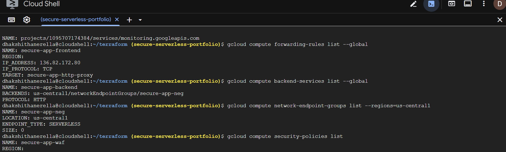

The resource listings confirmed the forwarding rule, backend service, serverless NEG, and Cloud Armor security policy.

### Result: URL Map Configuration

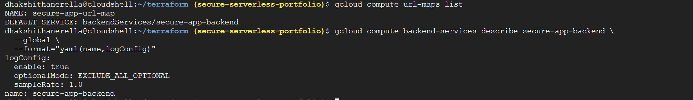

The URL map configuration routes requests to the configured backend service.

---

## Step 9: Test HTTP Requests and Cloud Armor Security

Used `curl` to test the load balancer frontend and Cloud Armor request-filtering behavior.

### Test 1: Normal HTTP Request

```bash
curl -sS -o /dev/null \
  -w "HTTP status: %{http_code}\n" \
  http://136.82.172.80/
```

**Expected behavior:** The application responds successfully for a valid route, typically with HTTP 200.

### Result: Normal HTTP Request

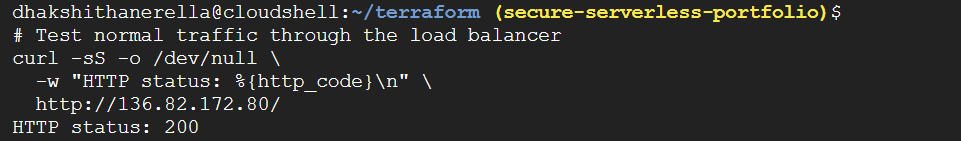

### Test 2: Blocked User-Agent Request

```bash
curl -sS -A "BadBot" -o /dev/null \
  -w "HTTP status: %{http_code}\n" \
  http://136.82.172.80/
```

The Cloud Armor policy is configured to deny requests containing `BadBot` in the User-Agent header.

**Expected behavior:** HTTP 403 Forbidden.

### Result: Cloud Armor Security Test

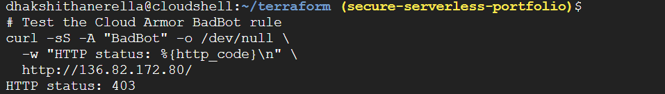

### Security Test Summary

| Test | Expected Response |
|---|---|
| Normal HTTP Request | Application response for a valid route |
| BadBot User-Agent Request | HTTP 403 Forbidden |

The expected responses should be compared with the actual terminal outputs shown in the screenshots.

---

## Step 10: Enable Cloud Logging

Enabled Google Cloud Logging to inspect application requests and responses.

### Enable Logging API

```bash
gcloud services enable logging.googleapis.com
```

### Read Cloud Run Logs

```bash
gcloud run services logs read secure-app \
  --region=us-central1 \
  --limit=30
```

The Cloud Run logs included HTTP 200 responses and HTTP 404/405 responses for other paths or unsupported methods.

Backend request logging was also enabled through Terraform.

### Result: Logging and Monitoring APIs

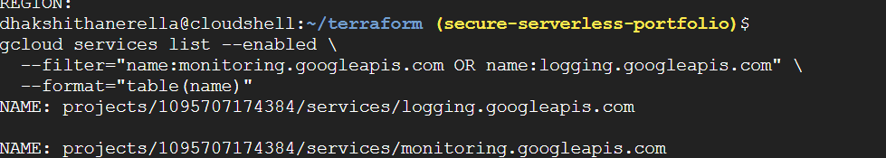

---

## Step 11: Create Cloud Monitoring Dashboard

Created a custom Cloud Monitoring dashboard to visualize application request activity, latency, and load balancer metrics.

The dashboard contains three monitoring charts.

### Chart 1: Cloud Run Request Count

**Metric:** Cloud Run Revision Request Count

**Filter:** `service_name = secure-app`

This chart tracks the number of incoming requests handled by the Cloud Run application.

It helps provide visibility into application traffic and request activity.

### Chart 2: Cloud Run Request Latency

**Metric:** Cloud Run Revision Request Latency

**Filter:** `service_name = secure-app`

This chart displays request latency for the Cloud Run application.

It helps analyze application response times and observe changes in request processing latency.

### Chart 3: Load Balancer Backend Request Count

**Metric:** Backend Request Count per Application Load Balancer

This chart displays the available load balancer backend request count metric.

The metric was added without a verified backend-specific filter.

### Result: Cloud Monitoring Dashboard

The following dashboard combines the three charts to provide visibility into application traffic and performance.

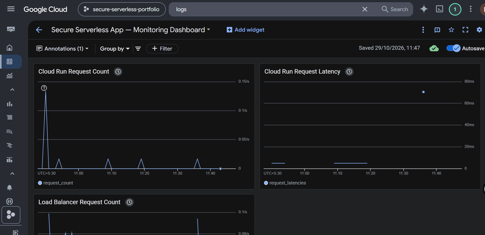

**Dashboard Components:**

- Cloud Run Request Count
- Cloud Run Request Latency
- Load Balancer Backend Request Count

---

## Step 12: Configure Cloud Monitoring Alerting

Created an alerting policy to monitor high request rates.

### Alert Configuration

| Property | Configuration |
|---|---|
| Alert Name | Secure App - High Request Rate Alert |
| Condition | Cloud Run High Request Rate |
| Metric | Cloud Run Request Count |
| Threshold | Above 1 request/second |
| Retest Window | 5 minutes |
| Status | Enabled |

The alert policy was configured with a demonstration threshold to monitor elevated request activity.

### Result: Cloud Monitoring Alert Policy

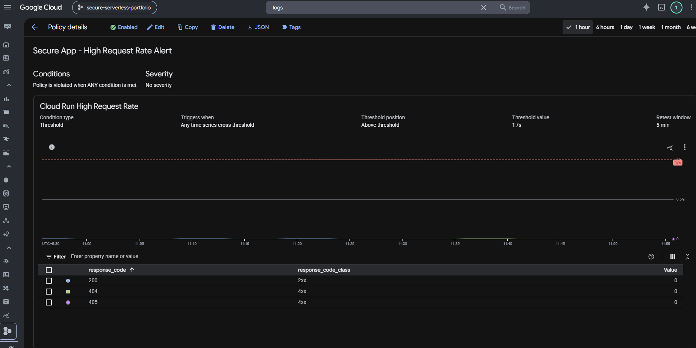

The screenshot shows the configured alert policy and its enabled status.

---

## Step 13: Validate Terraform Infrastructure

Validated the Terraform configuration and reviewed the infrastructure tracked in Terraform state.

### 13.1 Check Terraform Version

```bash
terraform version
```

**Terraform Version:** 1.7.5

### 13.2 Inspect Terraform State

```bash
terraform state list
```

The Terraform state contained six managed resources:

```text
google_compute_backend_service.backend
google_compute_global_forwarding_rule.frontend
google_compute_region_network_endpoint_group.serverless_neg
google_compute_security_policy.waf_policy
google_compute_target_http_proxy.http_proxy
google_compute_url_map.url_map
```

### Result: Terraform State Verification

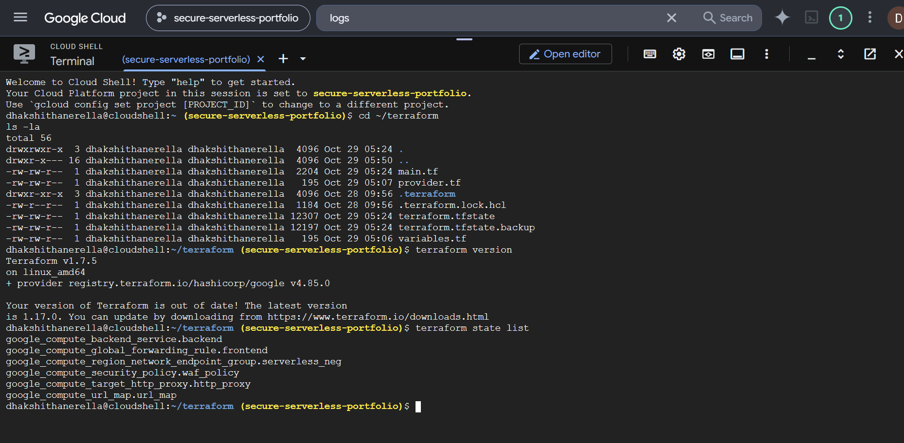

### 13.3 Validate Terraform Configuration

```bash
terraform validate
```

**Observed Output:**

```text
Success! The configuration is valid.
```

### 13.4 Review Terraform Plan

```bash
terraform plan
```

**Observed Output:**

```text
No changes. Your infrastructure matches the configuration.
```

The plan confirmed that the Terraform-managed infrastructure matched the configuration at the time of verification.

### Result: Terraform Validation and Plan

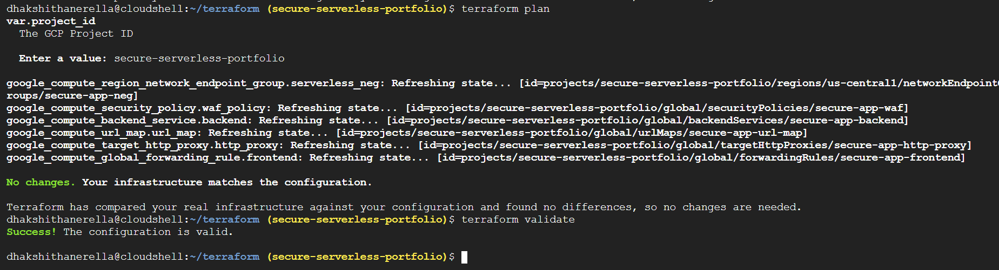

---

## 5. Repository Structure

```text
secure-serverless-portfolio/
│
├── README.md
│
├── architecture/
│   └── architecture.png
│
├── terraform/
│   ├── main.tf
│   ├── provider.tf
│   └── variables.tf
│
└── screenshots/
    ├── 01-cloud-run-service.png
    ├── 04-monitoring-logging-apis.png
    ├── 05-load-balancer-and-cloud-armor-resources.png
    ├── 06-backend-service-logging.png
    ├── 07-cloud-armor-waf-rules.png
    ├── 08-url-map-and-logging.png
    ├── 09-normal-request.png
    ├── 10-badbot-blocked.png
    ├── 11-cloud-monitoring-dashboard.png
    ├── 12-monitoring-alert-policy.png
    ├── 13-terraform-version-and-state.png
    └── 14-terraform-validate-and-plan.png
```

**Infrastructure Management Note:** Terraform manages the load balancer, serverless NEG, and Cloud Armor resources. The Cloud Run service, Artifact Registry image, monitoring dashboard, and alerting policy were configured separately and are not provisioned by the six Terraform resources listed.

Terraform state files, local provider directories, and private credentials should not be uploaded to the public repository.

---

## 6. Key Learnings

Through this project, I gained practical experience in:

- Deploying and configuring containerized applications using Google Cloud Run.
- Restricting Cloud Run ingress and routing requests through an external load balancer.
- Integrating serverless applications with load balancers using Network Endpoint Groups.
- Implementing Cloud Armor WAF request-filtering rules.
- Managing GCP infrastructure using Terraform.
- Configuring backend request logging and inspecting Cloud Run logs.
- Creating Cloud Monitoring dashboards for application request counts and latency.
- Configuring Cloud Monitoring alerting policies.
- Validating Terraform configurations and inspecting infrastructure state.

---

## 7. Conclusion

This project demonstrates the implementation of a security-focused serverless application architecture on Google Cloud Platform.

By integrating **Google Cloud Run, Artifact Registry, External Application Load Balancing, Cloud Armor WAF, Terraform, Cloud Logging, and Cloud Monitoring**, the project provides hands-on experience with serverless deployment, cloud networking, application-layer security, infrastructure as code, and observability.

The implementation strengthened my practical understanding of cloud infrastructure configuration, security controls, monitoring, and Terraform-based resource management.
